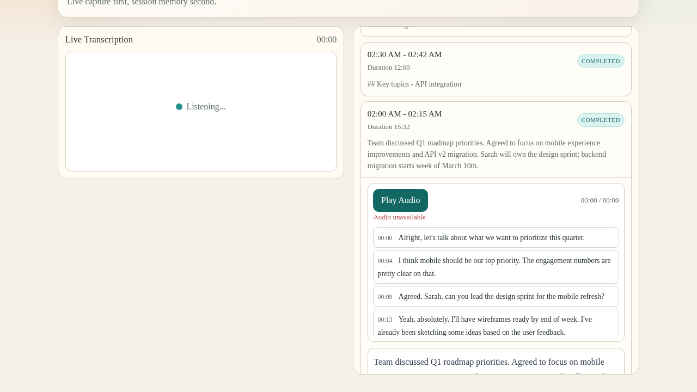

# Ghost Wispr

Always-on transcription appliance. Listens to your microphone, detects speech, and produces timestamped transcripts with session history, audio playback, and AI-generated summaries.


## What it does

Ghost Wispr runs as a background service on a machine with a microphone (e.g. a Raspberry Pi in a meeting room). It captures audio continuously, detects silence gaps to split recordings into sessions, sends audio to Deepgram for real-time transcription, and stores everything locally in SQLite.

When a session ends, it optionally generates a summary with a language model of any provider it is configured for ([Model providers](#model-providers)) and can sync audio files to Google Drive.

The web UI shows live transcription on the left and session history on the right. Click any past session to expand its full transcript and play back audio.

A summary whose model answers with no words (an empty summary, or only punctuation such as `...`) is not stored: Ghost Wispr asks again, and if every attempt answers so, the summary fails. The session keeps its last good summary, and its card shows why the summary failed and a "Retry summary" button. While a summary is being made, the card says so.



## Architecture

```
Microphone → Deepgram WebSocket → Session Manager → SQLite
                                       ↓
                                  Audio Recorder (MP3)
                                       ↓
                                  WebSocket Hub → Browser
```

**Backend** (Go):
- `cmd/ghost-wispr/main.go` — entry point, microphone/Deepgram orchestration
- `internal/session/` — silence-based session detection and lifecycle management
- `internal/audio/` — PCM recording with MP3 encoding
- `internal/storage/` — SQLite persistence (WAL mode)
- `internal/server/` — HTTP API, WebSocket event hub, SPA serving
- `internal/summary/` — session summaries
- `internal/config/` — settings, and the model providers each role names; `internal/providers/` — how Ghost Wispr signs in to each provider, and its check
- `internal/gdrive/` — Google Drive sync (optional)
- `internal/voice/` — the meeting voice: the Supervisor, the room-audio tap, the chimes; `internal/voice/tts/` is voice A, `internal/voice/gptlive/` voice B, `internal/voice/dgagent/` voice C
- `internal/wake/transcript/` — the wake phrase on the live transcript
- `internal/concierge/`, `internal/dispatch/`, `internal/envoy/` — the Concierge, its Dispatch client and the unit's Envoy session

**Frontend** (Svelte 5):
- PWA with offline support
- Real-time transcript updates via WebSocket
- Session history grouped by date
- Audio playback with seek-to-segment

## Requirements

- Go 1.25+
- Node.js 22+
- A USB or built-in microphone (PortAudio)
- A key or sign-in for each model provider you use ([Model providers](#model-providers)): with
  `ghost-wispr.yaml.example`, a Deepgram API key (for transcription) and an OpenAI API key (for summaries)

### System dependencies

PortAudio is required for microphone access, and ALSA's library for the speaker on Linux
(`portaudio19-dev` depends on `libasound2-dev`):

```bash
# Debian/Ubuntu/Raspberry Pi
sudo apt-get install portaudio19-dev libasound2-dev

# macOS
brew install portaudio
```

## Setup

```bash
# Clone
git clone https://github.com/sjawhar/ghost-wispr.git
cd ghost-wispr

# Configure
cp .env.example .env
# Edit .env with your API keys

# Build
make build

# Run
source .env && ./ghost-wispr
```

The web UI is available at `http://localhost:8080`.

## Configuration

Settings live in `ghost-wispr.yaml`, the release config (see `ghost-wispr.yaml.example`). Environment variables with the `GHOST_WISPR_` prefix override them, and a model provider's key is read only from the environment variable its `auth.env` names ([Model providers](#model-providers)). See `.env.example` for the full list.

The settings page saves its changes in the local settings file, `ghost-wispr.local.yaml`, beside `ghost-wispr.yaml`. For `GHOST_WISPR_CONFIG=/srv/unit.yaml`, the file is `/srv/unit.local.yaml`. The file holds only the settings that differ from the release config, and Ghost Wispr reads it over the release config: a map merges key by key, and any other value, a list too, replaces the release value. A summary preset that a save changes is written whole, with all four of its fields, so the preset keeps its other fields at the next start. A save never writes `ghost-wispr.yaml`, so a new release config keeps the saved settings. A save also writes each setting that an environment variable overrides, except `GHOST_WISPR_LOG_LEVEL`, and that setting stays after the variable is removed. To remove the saved settings, delete `ghost-wispr.local.yaml` and restart Ghost Wispr. When Ghost Wispr cannot read or parse `ghost-wispr.local.yaml`, it warns at start and in `GET /api/status`, and uses the release config alone.

| Variable | Required | Default | Description |
|----------|----------|---------|-------------|
| `GHOST_WISPR_DEEPGRAM_API_KEY`, `GHOST_WISPR_OPENAI_API_KEY` | For the roles that use them | — | The keys of the `deepgram` and `openai` providers that a config with no `providers` section gets: transcription and summaries |
| `GHOST_WISPR_SUMMARIZATION_MODEL`, `GHOST_WISPR_TRANSCRIPTION_MODEL` and each other role's variable | No | the file's | A role's provider/model ([Model providers](#model-providers)) |
| `GHOST_WISPR_DB_PATH` | No | `data/ghost-wispr.db` | SQLite database path |
| `GHOST_WISPR_AUDIO_DIR` | No | `data/audio` | Directory for audio files |
| `GHOST_WISPR_SILENCE_TIMEOUT` | No | `30s` | Silence duration to end a session |
| `GHOST_WISPR_LOG_LEVEL` | No | `info` | Log level (`log_level`): `debug`, `info`, `warn` (or `warning`) or `error`, in any case. Another value logs at `info`, with a warning at start and in `GET /api/status`. The variable overrides the config for the run only: a settings save never writes the variable's level to `ghost-wispr.local.yaml` |
| `GHOST_WISPR_MIC_SAMPLE_RATE` | No | `16000` | Preferred microphone sample rate |
| `GHOST_WISPR_MIC_SAMPLE_RATES` | No | `48000,44100,32000,24000` | Fallback sample rates to try |
| `GHOST_WISPR_GDRIVE_FOLDER_ID` | No | — | Google Drive folder for audio sync |
| `GHOST_WISPR_PUBLIC_URL` | No | — | The unit's own HTTPS address (`public_url`), such as its tailnet name: pages there may use the API, and Envoy events link to sessions under it |
| `GHOST_WISPR_RECORDING_RULES` | No | — | The rules the web UI shows under Recording rules (`recording_rules`), as a JSON list of strings. A settings save writes them into `ghost-wispr.local.yaml`, where they stay after the variable is removed |
| `GHOST_WISPR_ENVOY_ENABLED`, `GHOST_WISPR_ENVOY_HUB_URL` | No | `false`, — | Publish session events to the Envoy hub's listener (`envoy_enabled`, `envoy_hub_url`; [Envoy events](#envoy-events)). It turns only the events on or off: the meeting voice's own Envoy session follows `concierge.envoy_url` alone |
| `google_credentials_file` | No | — | Authoritative Google credential file, for Google Drive and each provider that signs in with Google; when empty, Application Default Credentials are used |

`ghost-wispr google-id-token --audience URL` mints an ID token from this credential file. Use `--credentials PATH` to override it for one command. `ghost-wispr --help` lists every subcommand.

## Model providers

`providers` in `ghost-wispr.yaml` names each model provider once: the wire API it speaks (`api`),
its address (`url`) and how Ghost Wispr signs in to it (`auth`). Every role names a provider and a
model as `provider/model`, split at the first slash, so a model may hold slashes of its own:
`gateway/openai/gpt-x` is the model `openai/gpt-x` at the provider `gateway`. No provider holds a
secret in the file.

```yaml
google_credentials_file: /etc/ghost-wispr/google-credentials.json
providers:
  gateway:                  # a model gateway that speaks the OpenAI API
    api: openai
    url: https://gateway.example.test/v1
    auth:
      kind: google_id_token
      audience: example-gateway
  vertex:
    api: vertex
    project: example-project
    location: global
    auth:
      kind: google
    labels:                 # what Cloud Billing attributes its Gemini calls to
      owner: example-owner
  vertex-us:                # the same project in Vertex AI's us multi-region
    api: vertex
    project: example-project
    location: us
    auth:
      kind: google
    labels:
      owner: example-owner
  openai:
    api: openai
    auth:
      kind: openai_wif
      identity_provider_id: idp-example
      service_account_id: user-example
  deepgram:
    api: deepgram
    auth:
      kind: api_key
      env: GHOST_WISPR_DEEPGRAM_API_KEY
transcription:
  model: deepgram/nova-3
summarization:
  model: vertex/gemini-4-carbon
embedding:
  model: gateway/gemini-embedding-2
concierge:
  model: vertex/gemini-3.5-flash-lite
tts:
  model: vertex-us/gemini-3.8-flash-tts
  voice: Kore
voice:
  gptlive:
    model: openai/gpt-live-1
  dgagent:
    provider: deepgram
```

A config file with no `providers` section gets two: `deepgram` and `openai`, with API keys from
`GHOST_WISPR_DEEPGRAM_API_KEY` and `GHOST_WISPR_OPENAI_API_KEY`, and the role defaults in the
table below, so a Deepgram key alone transcribes. A file with a `providers` section has only its own
providers and names each role's model. An empty section (`providers: {}` or `providers: null`)
has no providers.

| Provider field | Meaning |
|----------------|---------|
| `api` | The wire API: `openai` (the OpenAI API), `anthropic` (Anthropic's Messages API), `vertex` (Google Vertex AI), `gemini` (Google's Gemini API), `deepgram`, `elevenlabs` or `google-tts` (Google Cloud Text-to-Speech) |
| `url` | The API's base URL. Empty is its public address: `https://api.openai.com/v1`, `https://api.anthropic.com`, `https://generativelanguage.googleapis.com`, `https://api.deepgram.com`, `https://api.elevenlabs.io`, `https://texttospeech.googleapis.com`, and for Vertex AI the host of its location. An OpenAI API URL ends in `/v1` |
| `project`, `location` | Vertex AI only: the Google Cloud project (by default the project of a service-account credential file), and the location: `global` (the default), `us`, `eu` or a region such as `us-central1` |
| `labels` | Vertex AI only: request labels, such as `owner: example-owner`, that each Gemini generate call on the provider carries (`generateContent` and `streamGenerateContent`: summaries, the Concierge and Gemini TTS); Vertex AI copies them into Cloud Billing for pay-as-you-go traffic. Each provider carries its own. Embeddings and the provider check carry none. Google's rules allow a key of 1 to 63 lowercase or international letters, digits, `_` or `-` that starts with a letter, a value of up to 63 of them, and at most 64 labels a call. Labels that break these rules warn at start, and are sent as written: Vertex AI answers such a call, but Cloud Billing may not attribute spend by them. Labels on another API warn at start, and its calls carry none |
| `auth.kind` | How Ghost Wispr signs in, one of the kinds below |
| `auth.read_only` | `api_key` only: `true` means the deployment owns the `auth.env` key. The settings page does not offer a key input, and a `provider_keys` PATCH for it returns 400 |

| `auth.kind` | What Ghost Wispr sends | Its settings |
|-------------|------------------------|--------------|
| `api_key` | The key in the environment variable `auth.env`, or in `.env`, where the settings page saves it unless `auth.read_only` is true | `env`; `read_only` |
| `google` | A Google access token from `google_credentials_file` (workload identity federation or a service-account file), else from Application Default Credentials. Vertex AI and Cloud Text-to-Speech only | — |
| `google_id_token` | A Google ID token for `auth.audience`, minted from `google_credentials_file`, else from Application Default Credentials: an external-account credential (workload identity federation) by impersonating the service account it names, a service-account key file, or on a Compute Engine VM with neither, the VM's service account from its metadata server. For an endpoint that admits Google ID tokens, such as a model gateway, at its `url` | `audience` |
| `openai_wif` | An OpenAI access token that OpenAI's workload identity federation gives in exchange for a Google ID token, minted as for `google_id_token`. The OpenAI API only | `identity_provider_id`, `service_account_id` (ids, not secrets) |

A request signed in by `google`, `google_id_token` or `openai_wif` that gets a 401 is sent once
more with a new token when its body can be replayed. Otherwise it fails, but the next request gets
a new token.

| Role | Variable | APIs it can call | Default with no `providers` | What it does |
|------|----------|------------------|-----------------------------|--------------|
| `transcription.model` | `GHOST_WISPR_TRANSCRIPTION_MODEL` | `deepgram` | `deepgram/nova-3` | Live transcription |
| `batch_transcription.model` | `GHOST_WISPR_BATCH_TRANSCRIPTION_MODEL` | `deepgram` | `transcription.model` | Transcribes a session's recording again after it ends |
| `summarization.model`, a preset's `model` | `GHOST_WISPR_SUMMARIZATION_MODEL` | `openai`, `anthropic`, `vertex`, `gemini` | `openai/gpt-4o-mini` | Summaries, titles and speaker names |
| `embedding.model` | `GHOST_WISPR_EMBEDDING_MODEL` | `openai`, `vertex`, `gemini` | off | Semantic search |
| `concierge.model` | `GHOST_WISPR_CONCIERGE_MODEL` | `vertex`, `gemini`, `openai` | — | The meeting voice's Concierge. On an `openai` provider it streams chat completions with tool calls, so a model gateway's OpenAI API serves it, with Claude, OpenAI or Gemini models |
| `tts.model`, `tts.voice`, `tts.max_length` | `GHOST_WISPR_TTS_MODEL`, `GHOST_WISPR_TTS_VOICE`, `GHOST_WISPR_TTS_MAX_LENGTH` | `vertex`, `gemini`, `openai`, `deepgram`, `elevenlabs`, `google-tts` | off; the model's default voice; 5000 characters | Text-to-speech: voice A, and `POST /api/tts/speak` |
| `voice.gptlive.model` | — | `openai` | `openai/gpt-live-1` | Voice B: speech-to-speech, OpenAI GPT-Live |
| `voice.dgagent.provider` | — | `deepgram` | `deepgram` | Voice C: Deepgram's Voice Agent. It names a provider alone: `voice.dgagent.think_model` uses Deepgram's own model names |

A role whose provider/model names no provider, or a provider whose API the role cannot call, is
off, and so is a role whose `api_key` provider has no key; the start warns about each, and
`GET /api/status` shows the warning.

A backlog of sessions to summarize (at start, four or more; or `POST /api/sessions/batch-backfill`)
goes as one batch job when `summarization.batch_jobs` is on, as it is by default, and
`summarization.model`'s provider is the Gemini API: batch jobs run on the Gemini API only. A Vertex
AI provider summarizes each session online, one call a session, whatever `batch_jobs` says: genai
sends Vertex AI no batch of inlined requests. With `summarization.batch_jobs: false` every backlog
is summarized online. A batch job the provider refuses goes online too, with a log line saying
why, and leaves no session summarizing. A batch job that ends failed, cancelled or expired leaves
none either: each of its sessions fails, with the job's end as the reason, and goes back to the
backlog. A batch job is polled with the provider that took it, whatever `summarization.model`
names later; once that provider is gone from the settings, speaks another API or has no key, the
unit gives the job up, and each of its sessions fails, saying why, and goes back to the backlog. A
batch job's result or failure applies to a session only while the job's claim is still the
session's summary attempt: a summary started since, as by the start's backlog after a restart
(which polls only the batch job it submits itself), keeps the session, and the old job's result
is dropped with a log line. `GET /api/batches/{name}` polls a job this unit submitted, and answers
404 for any other. A backlog takes each session whose summary is pending, failed, or empty, and
one the last run left running (the start makes it pending again), but never one whose summary is
being made now: `POST /api/sessions/batch-backfill` or `POST /api/sessions/backfill` (always
online) during the start's backlog summarizes each session once. A summary whose run ends with
neither its summary nor its failure stored (the store refused the write, or the run failed
otherwise) is pending again at once, so the next backlog of the same run takes it; only one the
stop cut off waits for the next start. A backlog's summaries reach the
page as they start, end and fail, as a Resummarize's do. Each model call of a summary has 3 minutes,
and an OpenAI or Anthropic API answer at most 8192 tokens; an answer that begins as a JSON object
but does not parse, such as one cut off at that limit, is asked again and never stored as the
summary.

### Text-to-speech

`tts.model` names a model at any of these providers, and `tts.voice` a voice by that provider's own
name; an empty voice is the provider's default:

- Gemini TTS, on Vertex AI (`vertex`) or Google's Gemini API (`gemini`), such as
  `gemini-3.8-flash-tts`: a prebuilt voice, such as `Kore` (the default). Streamed.
- OpenAI (`openai`), such as `gpt-4o-mini-tts`: a built-in voice, such as `alloy`, `coral` or
  `marin` (the default). Streamed.
- Deepgram Aura (`deepgram`): the model is the voice, such as `aura-2-harmonia-en`, and `tts.voice`
  names another Aura voice in its place. Streamed, with `mip_opt_out=true`.
- ElevenLabs (`elevenlabs`), such as `eleven_multilingual_v2`: a voice id; the default is Rachel's.
  Streamed.
- Google Cloud Text-to-Speech (`google-tts`): the model is a voice name, such as
  `en-US-Chirp3-HD-Charon`, whose start gives the language, and `tts.voice` names another voice in
  its place. Each text is one whole clip: Cloud Text-to-Speech's `text:synthesize` does not stream.

A streamed voice speaks a sentence's first audio before the provider has made the rest. Each HTTP
provider is asked once more 2 s after a 429, and a stream that sends nothing for 5 s fails.

A voice belongs to its model, so a settings change of `tts.model` that names no `tts.voice` sets
the voice to `""`, the new model's default. The settings page checks only that the provider serves
the model's API, not that the model speaks: when a provider refuses a `POST /api/tts/speak`,
`/api/status` warns, with `tts.model` and the provider's status and code, until a speech works; it
warns the same way, naming `tts.model`, when the provider returns no audio (the speak answers 502).
Search does the same, with a warning for its index and one for its questions. When the provider
refuses to index a session (at its end, or in a backfill), `/api/status` warns with
`embedding.model` and the provider's status and code until a backfill of the sessions missing from
search works. An index that works while that warning is up, and a settings save that changes the
key of `embedding.model`'s provider, start that backfill in the background, one at a time, so the
sessions the provider refused are indexed with no restart. A question to `GET /api/search/semantic`
that the provider refuses (it answers 500 and logs the refusal) warns the same way until a question
works; a question that works leaves the index warning up. A 401 asks to check the provider's
sign-in; a 403 says the provider refused this model to a sign-in that worked, as a gateway answers
`team_model_access_denied`.

### Route a role through a model gateway

A model gateway is one more provider. A role can call it when the gateway speaks one of the role's
APIs, in the table above:

1. Name it under `providers` with the API it speaks and its `url`: `api: openai` and a URL that ends
   in `/v1` for an OpenAI-compatible gateway. A gateway that also speaks Anthropic's API is a second
   provider, with `api: anthropic` and the URL without `/v1`; one that serves Google's
   `generateContent` routes is a provider with `api: gemini` and the gateway's root URL: Ghost
   Wispr calls `<url>/v1beta/models/<model>:generateContent` and `:streamGenerateContent`, the voice
   too, with `google_id_token`'s token in `Authorization` and no key header.
2. Sign in: `google_id_token`, with the audience the gateway checks, when it admits Google ID
   tokens and lists the unit's service account; or `api_key`, with the gateway's key in `auth.env`.
3. Name the gateway in the role, with the model as the gateway names it:
   `embedding.model: gateway/gemini-embedding-2`, `summarization.model: gateway/<model>`,
   `concierge.model: gateway/claude-haiku-4-5` or `gateway/openai/gpt-5-mini`.
4. Check that it signs in: the settings page lists it, or `GET /api/providers?refresh=1`. The check
   of an `api: gemini` provider lists its models (`GET <url>/v1beta/models`) and counts a short
   text's tokens on each. When that list answers 404, as a gateway's Google routes do, it makes one
   `generateContent` of each chat model instead, with at most one output token: the provider
   works once each answers, fails naming a model it refuses, and a speech model, which no cheap
   call proves, leaves it at Signed in.

Moving the role back to a direct provider is the same change.

### The settings page and the API

The settings page lists each provider: its API, address and sign-in, the roles that use it, and
whether it signed in when last checked; an `api_key` provider whose `auth.read_only` is not true has
a field for its key. A deployment-owned key says it cannot be changed there. The check signs in, and
where the API has a cheap read the credential must pass (a model list,
Deepgram's projects, the ElevenLabs user, Cloud Text-to-Speech's voices, or for Vertex AI a count
of a short text's tokens on each model the roles call there, which costs nothing and needs only the
predict permission), makes it; a Vertex AI refusal or 404 (no such model or location) of any of
those models fails, naming the model. For `openai_wif`, and for a Vertex AI provider none of whose
models can be counted (an embedding model's), the exchanged or minted token is the check. An
OpenAI, Anthropic or Gemini API provider, such as a model gateway, must also list each model its
roles call and answer one cheap call of each: an embedding of one word for an embedding model, and
for a chat model a completion of one token (OpenAI API; for a summarization model it asks for a
JSON schema of the summary's shape, as summaries do) or a count of a short text's tokens (Anthropic
and Gemini APIs). A gateway that admits the sign-in but refuses the model, as with
`team_model_access_denied`, so reads as failing. A vendor's own API lists dated models and not
their aliases, so there an unlisted model is decided by its call. Summaries on an OpenAI API
provider ask for strict structured output when the schema allows it, as the summary's does: its
`speakers` is a list of `{id, name, confidence}`, which the summary stores as `speaker_names`,
keyed by speaker id. A provider's status says Works when its answers proved every model its roles
call, and Fails, with the reason, when the sign-in, the read or a call failed. It says Signed in
(`"asked": false`) when the check proved the sign-in and not every model: signing in was the whole
check; a Vertex AI provider counted some of its models and cannot count another (an embedding
model's); the read was of the account alone (Deepgram's projects, the ElevenLabs user, Cloud
Text-to-Speech's voices), which proves no model, while a role calls a model on the provider; or a
role's use of a model has no cheap call (a speech model). The message names each model the check
did not prove, and the settings page shows it under Signed in, as it shows why a provider fails;
Works says no more. A provider no role calls works once its read accepts the credential. A provider's
credential goes only to its own `url`'s scheme and host: a redirect elsewhere stops the call.
Errors name the provider as `providers` names it, such as `gateway answered HTTP 403`. A check that
began with a key a save has since replaced is not kept as the provider's last check.

- `GET /api/providers` returns `{"providers": [...]}`: each provider's `name`, `api`, `url`, `auth`,
  `sign_in` (in words), `key_env` and `key_set` for an `api_key` provider, `checked`, `asked`, `ok`,
  `message`, `checked_at`, and `roles`, the config keys that name it. A provider checked in the last
  5 minutes keeps its last check; `?refresh=1` checks every provider now. No answer holds a
  credential.
- `GET /api/config` returns `tts` (`model`, `voice`) among its settings and, read-only, `providers` (each
  provider's settings, with no secret) and `models`: each role's provider/model as the running
  process resolved it, environment overrides included, under `live_transcription`,
  `batch_transcription`, `summarization`, `embedding`, `concierge`, `tts`, `tts_voice`, `gptlive`
  and `dgagent_provider`. It and each `PATCH /api/config` answer carry `revision: {run, count}`, the
  state of the config they hold: `count` rises by one with each change in this run of the unit,
  which `run` names. Of two answers in one run, the one with the higher count holds the later state,
  whichever order they arrive in; the settings page shows that one. An answer from another run than
  the one it shows (after a restart, or late from before one) it does not show: it reads
  `GET /api/config` again, which only the live run answers, one read at a time, and tries a failed
  read again after 1 s, then twice as long each time up to 30 s, saying meanwhile that the settings
  may be out of date. What a save sends does not depend on what is shown: General, Meeting voice,
  Integrations and an open preset send each field the person changed since a save of it last
  succeeded. A preset's Refine changes a field only where its output differs from the preset it
  started from, which `POST /api/config/presets/refine` answers as `from` (the preset as the unit
  held it); a field it returns unchanged keeps what was typed there, is not sent for it, and says
  "The refinement's text for this field was not applied, because you had edited it." Cancel drops a
  refinement still on its way, and Save waits while one runs. A
  field nobody is typing in shows the config the page last took. A config with another value for a
  field being typed in ends that edit for good; the field shows the new value and says "Changed on
  the unit or in another tab; your edit was replaced." until the next input in it.
- `PATCH /api/config` takes `provider_keys: {"<provider>": "<key>"}` for `api_key` providers whose
  `auth.read_only` is not true and writes each key into `.env` under the provider's `auth.env`; any
  other provider, a read-only provider, or a key containing control characters is a 400. It also takes `tts: {model, voice}`, `summarization: {model, presets}`
  and `voice: {enabled, engine}` among its other fields, refuses a summarization or text-to-speech
  model that no provider serves, and answers 400 to a field it does not know. A preset in
  `summarization.presets` changes only the fields the patch names, `null` deletes it, and a preset
  `model` or `description` of `""` clears it (a preset with no model uses `summarization.model`;
  `""` leaves its `system_prompt` and `user_template` as they are). A saved key reaches
  every client that signs in with it with no restart: search, the next live-transcription
  reconnect, speech and summaries. A check of the providers that read the settings before the save
  never gives them the key it replaced.
- A `PATCH /api/config` creates a summarization preset the config does not hold only when it names
  all four of the preset's fields (`description`, `system_prompt`, `user_template`, `model`) with a
  non-empty `user_template`, as the settings page's new preset does. Any other change to such a
  preset answers 404 and changes nothing: the page sends only a preset's changed fields, so it is an
  update to a preset deleted elsewhere.
- `POST /api/tts/speak` takes `{text, voice?}` and speaks with `tts.model`. Its headers
  `X-Ghost-Wispr-TTS-Model` and `X-Ghost-Wispr-TTS-Voice` name the model and voice the provider
  used. A provider that fails to synthesize the speech answers 502 (`TTS synthesis failed: …`); a
  speaker that fails to play it, 503 (`TTS playback failed: …`), as when there is none.

### Removed settings

These settings are gone, and setting one does nothing: a start that finds one in the config file,
the environment or the `.env` file beside the config warns and names what replaced it. The last
two rows are fields of the HTTP API; a `PATCH /api/config` that sends one answers 400.

| Removed | What replaced it |
|---------|------------------|
| `genai_backend` | A provider with `api: vertex` (and its `project` and `location`) or `api: gemini` |
| `gcp_project`, `gcp_location` | A Vertex AI provider's `project` and `location` |
| `deepgram_model`, `batch_transcription.provider` | `transcription.model`, `batch_transcription.model` |
| `embedding_model` | `embedding.model` |
| `summarization.base_url` | The `url` of the provider `summarization.model` names |
| `tts_provider`, `tts_model`, `voice.tts_engine`, `voice.tts_model` | `tts.model` |
| `tts_voice`, `voice.tts_voice`, `tts_max_length` | `tts.voice`, `tts.max_length` |
| `voice.tts_location` | The `location` of the Vertex AI provider `tts.model` names |
| `voice.gptlive.openai_identity_provider_id`, `voice.gptlive.openai_service_account_id` | The `auth` of the provider `voice.gptlive.model` names, with `kind: openai_wif` |
| `GHOST_WISPR_GCP_PROJECT`, `GHOST_WISPR_GCP_LOCATION`, `GHOST_WISPR_GENAI_BACKEND`, `GHOST_WISPR_EMBEDDING_BACKEND`, `GHOST_WISPR_EMBEDDING_LOCATION`, `GHOST_WISPR_VOICE_TTS_LOCATION` | The settings of the provider the role names |
| `GHOST_WISPR_DEEPGRAM_MODEL`, `GHOST_WISPR_BATCH_TRANSCRIPTION_PROVIDER` | `GHOST_WISPR_TRANSCRIPTION_MODEL`, `GHOST_WISPR_BATCH_TRANSCRIPTION_MODEL` |
| `GHOST_WISPR_TTS_PROVIDER`, `GHOST_WISPR_VOICE_TTS_ENGINE`, `GHOST_WISPR_VOICE_TTS_MODEL`, `GHOST_WISPR_VOICE_TTS_VOICE` | `GHOST_WISPR_TTS_MODEL`, `GHOST_WISPR_TTS_VOICE` |
| `GHOST_WISPR_TTS_API_KEY`, and any `GHOST_WISPR_..._API_KEY` that no provider's `auth.env` names | The variable a provider's `auth.env` names |
| `api_keys` in `GET` and `PATCH /api/config` | `providers` and `provider_keys` |
| `summarization.base_url` and `voice.tts_engine` in `/api/config`, `provider` in `POST /api/tts/speak` | `tts` in `/api/config`; the speech uses `tts.model` |

## Recording rules

`recording_rules` in `ghost-wispr.yaml` lists the rules that people in the room agree to. When
the list has a rule, the web UI shows a Recording rules button in its header. Its dialog shows
each rule as written, as plain text, and tells people how to pause the recorder and how to have a
segment deleted. With no rules, the page shows no button. `GET /api/config` returns the list as
`recording_rules`.

```yaml
recording_rules:
  - Say so before the meeting if you do not want it recorded.
  - Anyone can pause the recorder, at any time.
  - Ask the office manager to delete a segment.
```

Ghost Wispr opts out of Deepgram's
[Model Improvement Program](https://developers.deepgram.com/docs/the-deepgram-model-improvement-partnership-program)
on every request: the live stream and each pre-recorded transcription send `mip_opt_out=true`.
Deepgram then keeps the audio and its transcript only as long as it needs to process the request,
and does not use them to train its models.

## Recording light

With `indicator_light: blink1` the recorder captures only while the blink(1)'s LED 1 reads back
red.
With the light missing, or not reading back red, it starts no microphone and refuses a resume.
While no capture device is present, a resume is accepted and lights nothing: no microphone can
open, and the light is checked once one can;
if the light fails while it records, capture stops within one check (a second) without saving a
pause. `/api/status` then names the cause in a warning and reports `capture_state`
`light_unavailable`, and capture comes back once the light reads back red again, unless someone
paused it meanwhile. Any other value of `indicator_light` stops the recorder from starting, so a
typo cannot turn the light check off; leave it unset for a recorder with no light.

The blink(1) has two LEDs. LED 1, the top one (`blink1-tool --led 1`), is the recording light: red
means the unit records. Every check reads LED 1 alone back, and only exact red (255,0,0) lets audio
through; a read that fails, or any other colour, stops capture as above. The recorder writes both
LEDs red while it records and both off when it stops. LED 2, the bottom one, flashes green, half a
second on and half a second off, while an agent's answer or a joined agent's raised hand waits for
"Wispr, go ahead" (see "Meeting voice"). It goes back to red once nothing waits: the answer or the
hand is spoken, "Wispr, never mind" drops the answer, the hand comes down, or its session ends. At
a pause, a light hold or shutdown it goes off with LED 1, and it never flashes while the unit does
not record: in listening and in closed both LEDs are off, and a pause to either ends the session,
which drops its waiting answers and hands. "Wispr, start recording" in listening brings LED 1 to
red before LED 2 flashes again. It flashes only while room audio reaches the recording:
while LED 1 is red for another reason, as while the microphone closes after a pause or reopens,
LED 2 shows red. A check that finds LED 1 not red writes both LEDs red, and LED 2 stays red until a
check finds LED 1 red again. A flash writes LED 2 alone, holds the lock below as every command
does, and never counts as a light fault: a flash write that fails is tried again at the next step.
The black pattern the watchdog plays must turn both LEDs off, so a check takes a pattern as black
only when each of its lines is black on every LED; a black line on LED 1 alone would leave LED 2 as
it was.

Every microphone open, and PortAudio's device scan, which opens the microphone too, waits for
the blink(1) to read back red and keeps it red until the open has finished, so no microphone opens
while the light is off. Before it lights the blink(1) for an open, the recorder looks in
`/proc/asound` for a capture device, without opening one: while there is none, the light stays off,
`/api/status` warns `No microphone found`, and the start-up retry looks again every 15 seconds.
With `mic_device` set (a sound card's ALSA id or a word of its name, as `Jabra`; or
`GHOST_WISPR_MIC_DEVICE`), only that card's capture device counts, and the microphone opens that
card's input and no other, through ALSA's plug layer (`plughw`), so it captures at 16000 Hz
whatever rate the card takes; unset, any capture device counts and the default input opens.
A unit that starts paused scans only at its first resume. The speaker does not need the scan: on
Linux it plays through the ALSA playback device that `speaker_device` names (a PCM such as
`plughw:CARD=J75,DEV=0`, or a sound card's id or name, as `Jabra`), opening no microphone and
needing no red light, so it speaks while capture is paused. It opens one stream at the device's
native rate when the first sound is queued, mixes the voice and the chimes into it, and closes it
0.3 s after the last sound. While a chime plays, the voice plays 15 dB down, so that the two never
clip together; it goes down over 10 ms before the chime starts, and back up over 10 ms after.

The microphone is never open while the blink(1) is off. The light stays red while the microphone is
open, and goes off only once the recorder has closed it: after a pause, once no audio has reached
the recording for 2 s (`no_audio`; the recorder opens it again under a new red check after a wait
that doubles up to 30 s, so with a microphone that delivers nothing the light shows red for about
2 s at each retry while nothing is recorded), before it waits to reconnect after a stream error,
and at shutdown. A
pause turns the light off within 500 ms: that is the bound for A1 ("Tap the Pi's power button: the
light goes off"), and the tests hold the pause paths to it. If a pause cannot close the microphone,
the light stays red and `/api/status` warns until it closes. The recorder
reads the light back for each buffer of audio: once the light was not red while the microphone was
open, as when it went off outside Ghost Wispr (an unplug, its watchdog, another `ghost-wispr
light-off`), the recorder drops that audio and what the microphone holds, closes it and opens it
again under a new red check.

`ghost-wispr light-state` prints the colour of the blink(1)'s LED 1 and `ghost-wispr light-off`
turns both LEDs off, also while the recorder runs. The blink(1) has one report buffer: a read gets
the reply to the last command any program sent. So every command Ghost Wispr sends, from the
recorder or a subcommand, holds an exclusive `flock` on the blink(1)'s hidraw node from the command
to its reply, and a read takes only a reply that names its own command. A read selects LED 1 ('l'
0) and reads it ('r') in one hold of the lock: a blink(1) mk3 reads the LED that was selected last,
whatever LED the read names. A recorder command that does not
get the lock within 50 ms, or a subcommand's within 2 s, sends nothing: the recorder counts such a
read as the light not red, and `light-state` prints `unknown` and fails; `/api/status` warns that
the recording light is busy until the recorder's next look at the light gets through. A waiting
recorder gets the lock before a subcommand does, so `light-state` runs that finish do not make the
recorder drop audio. One that is stopped while it holds the lock (Ctrl-Z, `kill -STOP`) does: until
it is continued, each of the recorder's reads is unknown, so no audio is recorded and the microphone
opens only once the lock is free. The watchdog tickle and an off write, which wait for no reply,
are the exception: they are then sent without the lock, so another program that holds the lock does
not let the watchdog fire while the recorder runs, a pause still turns the light off within 500 ms,
and `light-off` still turns it off. A red write is not: it sends nothing. The recorder tickles only
a blink(1) whose stored pattern it found black, since the watchdog plays that pattern. When it
opens the light again after a device error, it knows the same unit by its serial number, so it needs
to ask it nothing, and tickles it at once, also while another program holds the lock. Any other
unit, or one with no serial number, gets off writes only, no tickle and no red, until a check finds
its pattern black: the one a resume, a gate opening or a microphone open runs before its red
confirmation, or one that a refused tickle or red write starts. That check sends one command at a
time, lets the recorder's other commands in between, and runs before a resume or a gate opening
takes the pause switch, from the web page, the power button or the Jabra alike, so a pause during it
is not held up and turns the light off at once; the resume, gate opening or microphone open it
overtakes lights nothing and opens nothing. A press of the power button or the Jabra that resumes
returns at once and checks the light in the background. Each press reads the state, except
while that button's own resume is still checking the light with no pause since: then the press
counts the unit as resumed, and pauses (the power button) or closes the microphone (the Jabra).
The Jabra's mute ring shows what its button counts: unmuted during that button's own resume, and
otherwise Muted in the closed state only (see [The three states of the microphone](#the-three-states-of-the-microphone)).
A refused resume returns the unit to the state it came from and lights the Jabra's ring again
there, so the next press resumes again. The check reads the
pattern the light plays, not the one it saves, so a unit is known black only once a save of the
black pattern reached it: a check that finds the pattern black saves it once more first, and a save
that does not reach the unit leaves it unknown, so it is checked again when it comes back, in this
process or the next. Two records per serial number in `blink1-saves/` next to the database bound
the flash writes: each save's attempt is recorded before it is sent, and no save is sent for a day
after one, nor when the attempt cannot be recorded; and a save seen to reach the unit is recorded
after it, which for a day lets a check that finds that unit's pattern black know it black without
a save. An attempt with no confirmed save after it, as after a crash or a failed transfer, leaves
the unit unknown. So a recorder restarted over and over writes the blink(1)'s flash at most once a
day. Ghost Wispr must be the only program that writes the blink(1)'s stored pattern, between
recorder runs too: a confirmed save that an earlier run recorded counts for a day, and another
program that writes the pattern in that time, even one that takes the lock, can leave the unit
known black while its stored pattern is lit. Programs that do not take the
lock, such as `blink1-tool`, must not run while the recorder runs: their own colour read can still
answer the recorder's.

A session starts when Deepgram hears the end of its first stretch of speech, and its recording
starts 5 s before the first word the live transcript holds, so the recording and the refined
transcript that replaces the live one hold every word from the first. To do that, while no session
is recording the recorder keeps the last 5 s of audio in memory, plus as much as Deepgram can fall
behind: the live client buffers up to 60 s (`deepgram_buffer_size`) while Deepgram is away, and
sends the piece of audio a failed send left unsent first, however old it is. The recorder keeps
enough to hold that piece after an outage of up to twice the buffer, 120 s, and 30 s for
Deepgram's late results: 155 s in all. After a longer outage the piece is still transcribed, but
no recording holds it. From the first words Deepgram hears until the session starts, it keeps all
the audio after them too, up to 300 s, or as much as it keeps before them when that is more. It
keeps only audio captured while the light was red: every close of the microphone (a
pause, the light reading back off or failing, no audio reaching the recording) drops it, and no
audio of an earlier session is ever kept. A session's start time is when its recording starts.
Deepgram can give its words for the last seconds before a pause, or before a session's recording
closed, only after the resume or the end, as when it lags after an outage; the recorder places each
word in the audio it captured, and drops every word from before the pause or the close, so none
reaches a later session, and none reaches the page or the voice during a pause.

## The three states of the microphone

The microphone is in one of three states. The light shows red in recording only, and the Jabra's
mute ring shows Muted in closed only.

| State | Light | Jabra ring | Microphone | What the unit captures and sends |
| --- | --- | --- | --- | --- |
| recording | red | not muted | open | Audio passes the capture gate to the recording, Deepgram and, during an exchange, the voice |
| listening | off | not muted | open, for the paused listener only | Only the paused listener hears the room, for "Wispr, start recording" or "Ghost Wispr, start recording". Its audio goes to a keyword spotter in Ghost Wispr's own process and a ring of at most 2 s, zeroed at every change of state. It stores, sends and logs nothing: no audio reaches the recording, Deepgram or a voice, and no event, message or row comes of it |
| closed | off | muted | closed | Nothing |

- The power button and the page's Pause move recording to listening while the paused listener can
  run, and to closed otherwise; from listening or closed, they resume. A pause in listening or
  closed changes nothing.
- The Jabra's mute button closes the microphone from recording and from listening, and resumes from
  closed: anyone at the table can close the microphone with one press. A report the Jabra sends by
  itself as one of its streams closes is dropped only when it would move the unit to recording.
- `POST /api/close` and the page's Close microphone close it from every state.
- "Wispr, start recording" in listening resumes as `POST /api/resume` does: the light must read
  back red before any audio passes the gate. In closed nothing hears it, and in recording it is not
  a control.

The paused listener can run only with `voice.enabled` and `voice.paused_listener` both on (with the
voice off, nothing hears the room for a wake phrase), in a build that has it (`go build -tags kws`,
after `deploy/sherpa/fetch.sh`; the release binary has it), while the Jabra's mute button is
attached, and once its spotter has loaded. Otherwise every pause closes the microphone, as
before the listener. A pause saved before the listener comes back closed, so its first deploy
opens no microphone. A saved listening comes back closed at start-up until the Jabra's button is
attached and the listener has started, then listening. A listening unit goes to closed when the
Jabra's button detaches, when either setting turns off, and when the listener's capture
fails, and stays closed until a person resumes. A resume the light refuses returns the unit to the
state it came from.

The listener is an ALSA capture in Ghost Wispr's own process, with no PortAudio and no other
process, on the card `mic_device` names. It closes before the recording microphone opens, or
waits to open, and before any PortAudio scan; it opens only once the recording microphone has
closed, so the two are never open together. The service unit sets `LimitCORE=0` and
`MemorySwapMax=0`, and the process turns its core dumps off as the listener starts, so the ring
never reaches the disk. The spotter is sherpa-onnx's keyword spotter with its GigaSpeech model,
linked into the binary: its weights are Apache-2.0, and GigaSpeech, the audio it was trained on, is
licensed for research. When it hears the phrase, it decodes the ring once more as text and accepts
only text that holds "STAR", so "Wispr, stop recording" does not resume. A phrase, or a capture
failure, belongs to the stretch of listening its audio was read in, and moves nothing once that
stretch has ended: a close, a detach, a setting turned off or a new stretch wins over it. On the
office Pi, `voice.paused_listener` stays off until a measurement on 10 h of speech counts fewer
than 0.5 false starts an hour (`go run -tags kws ./cmd/measure-wake -mode listener`), with both its
controls fired: the listener heard the start phrases spliced into that speech, and the same
pipeline, listening for a keyword the speech says often ("and then") in place of the phrase,
counted at least 10 hits in it. Without them the run prints
UNKNOWN. `ghost-wispr kws-selftest CLIP.wav...` checks a build's spotter on stored clips and times
it. The release ships `THIRD_PARTY_NOTICES.md`, which carries the licence and notice texts of the
code and model the listener links, whole.

## Meeting voice

With `voice.enabled`, people in the room can ask Wispr about the work tracked in Dispatch. They
say the wake phrase at the start of a sentence: "Wispr, what is happening with the issue about
the meeting voice?" ("Ghost Wispr" and "Hey Wispr" work too; "I will whisper it to you" does not).
Wispr plays a short two-note sound, the Concierge reads Dispatch's record, and the voice speaks the
answer. For 6 s after Wispr's answer, a follow-up that the transcript ends with a question mark needs no wake phrase, and so does a reply when Wispr asked ("Did you mean Infra forty-five ninety-two, or
Infra ten twenty-seven?", each key as people say one). Anything else said in those 6 s is side talk: no voice answers it, and nothing of it goes to Dispatch.
"Thanks, Wispr" ends the exchange. When the record cannot answer, the Concierge asks the agent that holds the issue. When
its answer lands, Wispr plays a rising three-note sound twice after a second in which nobody speaks, the
blink(1)'s LED 2 flashes green while the unit records (see "Recording light"), and Wispr speaks
the answer on "Wispr, go ahead" ("Wispr, go ahead, ABC-12" picks one of several). It speaks by
itself only when nobody has spoken since the question and the light still reads red. "Wispr, never
mind" cancels the newest question to an agent that has not answered yet; with no such question, it
drops the meeting's newest answer still waiting, which then never sounds or speaks, and LED 2 stops
flashing once no answer waits. The dropped answer stays in writing on the session's page.
"Wispr, stop" stops it, and so does talking over it
with real words; "mm-hm" or "yeah" alone does not. Only words said while it plays count, timed by
when the microphone read them: the question it answers, or one asked in a pause, does not stop it
when the live transcript sends that question's words late, up to about 8 minutes of audio. Other speech (`POST /api/tts/speak`) waits in
its queue while the voice speaks. Two more sounds: a single high note when capture starts
recording, and a falling two-note sound when Wispr cannot do what was asked (Dispatch or Envoy out
of reach, a voice that fails, or a failed red check). A Dispatch search that finds nothing in its
time is no outage: Wispr says "Dispatch's search is slow right now." with no error sound; a search
Dispatch refuses is an outage, even when the refusal's body never comes. A key with a one-digit
number is read as a key only when its project is one of Dispatch's and it is written as a key
("INFRA-7") or said as the question's whole object ("what about Infra seven", "Infra 7"); inside
other speech it is speech ("I bet 5", "the Infra 3 times", "Ops 1 and 2"), as are "the last 7 days"
and "one" after a project ("the Infra one"). Wispr says an issue's status in words ("needs
review"), even when its model writes the status as Dispatch does.

The settings page turns the voice on or off and picks the voice and the text-to-speech provider, with no restart; the change
applies from the next exchange. With the voice off, the unit reads no wake phrase and runs no
Concierge, and plays only the start sound and the error sound of a failed red check.

What the voice hears, and where the room's words go:

- The voice hears the room only while the light reads red. Its wake phrase is read from the live
  transcript, and its room audio is one more writer behind the same gate as the recording and
  Deepgram. While capture is paused, nothing of the voice hears the room: no wake phrase is read,
  and nothing is sent. In listening, only the paused listener hears it, on the unit, for the start
  phrase alone.
- Every pause, light hold, press of the Jabra's Mute button, "Wispr, stop" and shutdown stop the voice at once: its speech, its
  chimes and the Concierge's calls end within 100 ms, and a question not yet sent to an agent is not
  sent. Every gate closing, a pause or a light hold, ends the recording session, and an ended
  session's answers are never spoken: they stay in writing on that session's page. A gate closing
  also clears the two minutes of transcript the voice keeps.
- Voice A, text-to-speech (`voice.engine: tts`), sends no room audio anywhere. The asker's words after the wake phrase go to the
  Concierge's model (`concierge.model`), with the last two minutes of the transcript. The text
  Wispr speaks goes to the text-to-speech provider `tts.model` names; a Deepgram Aura request
  carries `mip_opt_out=true`.
- Voice B, speech-to-speech (`voice.engine: gptlive`), sends room audio to OpenAI's GPT-Live, only while the light reads
  red, from the wake phrase to the end of the exchange: nothing said before the wake phrase goes. The
  audio held for the wake starts inside the phrase itself, about 0.3 s into it in our tests.
  An exchange opens at the wake phrase; a held answer also opens voice B without one, but only on
  "Wispr, go ahead", or when nobody has spoken since its question and the light reads red, and its
  room audio goes from that moment. An exchange ends 6 s after Wispr's speech unless a person speaks,
  after 10 s in which nobody and nothing speaks, and after 5 minutes at most. Between exchanges
  nothing goes to OpenAI. With the audio go the last two
  minutes of the transcript as text, and the Concierge's answers for GPT-Live to say in its own
  words. The session starts with `store: false`, so OpenAI stores no recording of it to fork later.
  The question and the transcript still go to the Concierge's model, as with voice A. With an
  `openai_wif` provider, the unit signs in to OpenAI with its own Google identity and holds no
  OpenAI key.
  A measured limit of voice B: GPT-Live sends its words just before their audio, and their
  timestamps run on a clock the unit cannot follow, so the unit takes each word as it arrives. When
  someone talks over Wispr, the words GPT-Live had already sent count as spoken, though up to about
  1.4 s of them never played. In that time, matching calls and commands can be ignored for up to 30 s while Wispr speaks or its echo can still be heard.
  That is broader than barge-in: `Wispr, never mind` can be ignored too when its words match an unplayed cut answer.
- With `voice.engine: dgagent` (voice C, a voice agent), during an exchange only, the unit streams the room's
  audio and the last two minutes of the meeting's transcript to Deepgram's Voice Agent, with
  `mip_opt_out` set so Deepgram does not use them to train its models. Deepgram's model keeps the
  turn: Deepgram's own model, or the provider `voice.dgagent.think_model` names (such as Google);
  when that model fails a turn, Deepgram hands the turn, with the same transcript, to OpenAI's gpt-4.1-mini.
  Each question goes to the Concierge on the unit, whose own model (`concierge.model`) words the
  answer, and Deepgram speaks it word for word. An exchange opens at the wake phrase; a held answer also opens voice C without one, but only on "Wispr, go ahead", or when nobody has
  spoken since its question and the light reads red. Between exchanges nothing goes to the Voice Agent.
- Voice C plays only the Concierge's words and routing lines. The words of Deepgram's own model
  never play, within one bound. No message from Deepgram says which sentence an audio frame belongs
  to, so each frame of an answer waits 250 ms before it plays. When the model's own text comes, or
  Deepgram hears someone start to speak over the voice, the frames still waiting are dropped. Model
  audio that comes more than 250 ms before its own text would play. The probe measured that lead at
  24 ms at most, over 146 sentences in 28 real sessions. The wait makes each answer start 250 ms later.
- Dispatch's search gets the question as spoken, without the wake phrase. When Deepgram's final
  result drops the name or writes it otherwise ("Mister"), the turn is that result whole, so words
  said just before the wake can go with the question. Each search runs two of Dispatch's searches
  at once:
  - Its search by words and meaning gets the question whole: in lower case, without the
    punctuation around each word, a name spelled letter by letter written as the word it spells,
    and an issue key left out (a key of one of Dispatch's projects, or, while the unit cannot tell
    Dispatch's projects because it has not read them or its last read failed, any word that reads
    as a key). This search sends the question to Dispatch's embedding model, Cohere Embed v4 on
    Microsoft Azure, even when the keyword search answers first.
  - Its keyword search, which reaches no embedding model, gets only the question's words that name
    work, without words such as "what", "the" or "happening" and without anything that reads as a
    key. For "the issue about X", it gets X's words alone.

  The voice starts its search while the person is still speaking, once the words said so far
  have stayed the same for 0.4 s, so the start of a question can reach Dispatch and the embedding
  model before the person finishes it. With voice B or C, an answer whose read-ahead did not
  search the unit's own transcript of the question searches the vendor's text of it: GPT-Live's
  transcript joined to the unit's, or the wording of Deepgram's think model, which holds the last
  two minutes of the transcript. When the Concierge's model searches again, it
  sends the question or the description of the work in its own words, which can draw on the last
  two minutes of the transcript it holds, and that text goes the same way. Dispatch searches at
  most 1000 characters, so a longer text is cut there, between words. A search's words travel in
  the query of its address, which Dispatch's access log does not keep. An issue key the asker
  says ("infra 4592") goes to Dispatch in the address of that issue's read, which Dispatch's
  access log records. A number said after a word that is no project of Dispatch ("the last 30
  days") is not read as a key, and stays in the question. "In for" reads as INFRA only before a
  number of three or more digits, as Deepgram sometimes writes "infra 4592"; "in for thirty
  minutes" is no key.
- When the record cannot answer, the Concierge asks the agent that holds the issue, over Envoy.
  The message carries the asker's question, framed as a read-only question from someone the unit
  cannot identify, with the recording session's id and time, not the transcript. A question sent to
  an agent leaves the unit, and deleting the segment or the session cannot recall it: Envoy keeps
  messages for 72 hours, and the agent keeps what it read. The agent reads the question with its
  own model, so the question also reaches that model's vendor.
- The unit stores none of the room's words for a question it sent: its `voice_tasks` ledger holds
  the issue, the holder, the state and the agent's written answer, which the session's page shows
  under "Questions to agents". Deleting a session erases its questions and the answers the agents
  wrote. An agent's written answer may quote the asker, and only a session delete erases it: a segment delete does not.
- An agent a person invites through Dispatch can join the meeting (below). It reads the words from
  the unit's own API, which honours deletions, never from a copy the unit sends it: the unit sends
  a joined agent a pointer, a recording session and a time range with no words, when its issue
  comes up, at most once a minute. What the agent read before a deletion stays in its session, and
  the unit cannot recall it. A joined agent's floor request holds the agent's own words, which the
  voice speaks after its issue key, and the unit keeps them only until they are spoken or dropped.
- The voice's `/ws` events (`voice_wake`, `voice_exchange_started`, `voice_answer_ready`,
  `voice_spoken`, `voice_tasks_changed`, `agent_joined` and `agent_left`) carry the recording
  session's id and no words, and none is stored.
- A speech vendor's error message that quotes the text to speak is left out of the journal; the
  unit logs the vendor's status, and a note that the message was left out.

| Setting | Default | Description |
|---------|---------|-------------|
| `voice.enabled` (`GHOST_WISPR_VOICE_ENABLED`) | `false` | Turn the meeting voice on; it needs `speaker_enabled`. While it is on, the live Deepgram request carries `no_delay`, which ends the turn without Deepgram's wait for an entity (such as a spoken issue key) to look complete, so the voice answers fast; it trades some of Deepgram's number and entity formatting for that speed, and the voice reads a spoken key either way. With the voice off, a recording keeps Deepgram's full formatting |
| `voice.engine` (`GHOST_WISPR_VOICE_ENGINE`) | `tts` | The voice: `tts` (voice A, text-to-speech: the `tts.model` provider reads the Concierge's answers), `gptlive` (voice B, speech-to-speech: OpenAI's GPT-Live) or `dgagent` (voice C, a voice agent: Deepgram's Voice Agent with the Deepgram key; it hears the room, keeps the turn and speaks the Concierge's answers word for word) |
| `voice.dgagent.think_model` | Deepgram's `phonellm-mini-alpha-2-fp8` | Voice C: the model, as provider/model, that Deepgram runs to keep the turn, such as `google/gemini-3.1-flash-lite`; `open_ai/gpt-4.1-mini` stands behind it if it fails. `deepgram/think-fast` is refused: it needs Deepgram's model training, which voice C opts out of |
| `voice.wake_phrases` | `[Wispr, Ghost Wispr]` | The phrases that call Wispr; the live Deepgram request carries them, and Dispatch's project keys, as Nova-3 keyterms, with "Whisper" right after "Wispr", since Nova-3 knows how that word sounds. Besides "Whisper", the wake phrase reads "Lispr" and a few other spellings Deepgram writes for the name; never "Mister" and the like |
| `tts.model`, `tts.voice` | — | Voice A's text-to-speech provider/model and voice ([Text-to-speech](#text-to-speech)) |
| `voice.paused_listener` | `false` | A pause from the power button or the page goes to listening, where the paused listener hears only "Wispr, start recording" ([The three states of the microphone](#the-three-states-of-the-microphone)); it needs `voice.enabled`, a build with the listener and the Jabra's mute button. Turned off, a listening unit closes its microphone at once |
| `voice.gptlive.model` | `openai/gpt-live-1` with no `providers` | Voice B's provider/model, on an `openai` provider. With `openai_wif`, the unit exchanges its Google ID token (`google_credentials_file`) for an OpenAI access token of an hour at most. `gptlive-probe` (`cmd/gptlive-probe`) checks the route from the unit |
| `voice.dgagent.provider` | `deepgram` with no `providers` | Voice C's provider, a `deepgram` one, whose key opens the Voice Agent |
| `concierge.model` (`GHOST_WISPR_CONCIERGE_MODEL`) | — | The Concierge's provider/model, on a `vertex`, `gemini` or `openai` provider, such as `vertex/gemini-3.5-flash-lite`, or a model gateway's `gateway/claude-haiku-4-5` or `gateway/openai/gpt-5-mini`; without it the voice cannot answer |
| `concierge.dispatch_url` (`GHOST_WISPR_CONCIERGE_DISPATCH_URL`), `GHOST_WISPR_DISPATCH_TOKEN` | — | Dispatch and the unit's own token; without both, the voice says it cannot reach Dispatch yet |
| `concierge.envoy_url` (`GHOST_WISPR_CONCIERGE_ENVOY_URL`) | — | The Envoy listener the unit registers its session with, to ask an issue's agent. `envoy_enabled` does not turn this session off: it is for the events alone; without `concierge.envoy_url` the unit opens no Envoy session |

### Agents in a meeting

A person can tell an agent, through Dispatch, to join the meeting the unit records. The unit
writes the join message (`GET /api/voice/join-message?issue=KEY`), and the person sends it to the
agent's session (`dispatch send-to-agent`). It names the unit's own Envoy session and the whole
floor protocol, so an agent with an older copy of the Ghost Wispr skill can follow it. The agent
joins, asks for the floor and leaves with Envoy messages to that session, each one line:
`ghost-wispr join KEY`, `ghost-wispr floor` with its words on the lines after it, and
`ghost-wispr leave`. A join is taken on trust from any session Envoy does not list as gone, with no
check that a person invited it, since any agent on the tailnet can already ask the Concierge and
read the API, a pointer holds no words, and a hand speaks only on a person's "go ahead". A command
Envoy delivers again acts only once, for as long as Envoy can deliver it again (its stream keeps a
message 72 hours), and a floor request or a leave sent before the agent's latest join is not
taken. The unit keeps at most 4,096 commands of those 72 hours from one sending session, and
1,048,576 from all of them: a session past its share replaces its own oldest, which Envoy could then
deliver again, and past the total the session holding the most does. No command is refused, so one
session's flood cannot hold off another agent's. With 256 sessions at their share, the record holds
about 20 MiB; many sessions holding a command or two each cost more a command (131,072 sessions of
one command each, about 46 MiB, and about 8 MiB after they expire). A
command that comes before the unit's Envoy session is ready waits up to 2 s for it, then is not
acknowledged, so Envoy delivers it again.

A joined agent follows the meeting through the unit's own API, and gets a pointer with no words
when its issue comes up: a final segment that names its key, its number, or two words of its
issue's title, at most once in 60 s for an agent, across its joins.
`GET /api/sessions/{id}/joined-agents` lists the agents in a meeting, and so does the session's
page. Each joined agent's issue key becomes a keyterm of the live transcript from its join, with no
redial. "Wispr, ask the ABC-12 agent …" goes to the agent that joined on ABC-12 before the issue's
claim in Dispatch, and reaches it once.

A floor request is at most 50 words as the room hears them, the attribution the voice says first
("ABC-12's agent says:") included, written for the ear, at most one in 5 minutes for an agent,
across its joins. The room hears a short two-tap sound at the next gap, and LED 2 flashes green
while the hand is up, as it does for a waiting answer; LED 1 stays red. The voice says the words,
after the agent's issue key, only when a person says "Wispr, go ahead" ("Wispr, go ahead, ABC-12"
picks one of several), and drops them after 60 s; the agent is told which. "Wispr, never mind"
leaves a hand up: it drops answers only, and a hand still sounds while one waits. "Wispr, who has a
hand up?" names the agents waiting. An agent leaves when it says so, when the meeting ends or is
deleted, when the voice stops, or when Envoy lists its session as not live for 10 minutes. The
moment the recorder ends a meeting, or leaves recording for listening or closed, nothing more is
sent or spoken for it: not a pointer on its way, a hand's sound or words, nor an exchange of the
voice. A sound is its answers' or hands' until the speaker has played its last frame, so the last
hand coming down stops it wherever it has got to, and a hand raised while one plays gets a sound of
its own after it. A hand's sound stops with the membership of the last hand it sounds for, and a
sound cut before it played out (by an exchange, or by a never mind holding answers back) sounds
again.

## Deployment

The office recorder runs a Ghost Wispr release on a Raspberry Pi 5. Each release has the arm64
binary and the Pi's deploy set, `ghost-wispr-pi-deploy.tar.gz`: the Pi's config, its deployment
settings (`pi.env`), its units, its update scripts and `provision.sh`, with a `manifest.json` that
gives the SHA-256 of each file and of the binary. `deploy/pi/build-deploy-tarball.sh` builds it in
the release workflow.

- A person provisions a new Pi on the Pi, from the release. `provision.sh --key` makes the Pi's key
  and prints its certificate request. Once the infrastructure repository signs the request,
  `provision.sh --certificate FILE` installs the certificate, and `provision.sh` writes the Google
  credential files, installs the nightly update and joins the tailnet.
- Each night from 03:30 to 06:00, while the recorder is free, the nightly update installs the latest
  release's binary and config together, and puts the whole previous set back when the new release
  does not answer. A launcher runs it under a 45-minute time limit. The update prints a line for each
  install, hold and failure, and a drift line when a provisioning file or Tailscale Serve differs
  from the release.
- The Pi's Deepgram key and Dispatch token are in Secret Manager. The update and each start of the
  recorder read them with `ghost-wispr pi-secrets`, and the settings page cannot change the
  Deepgram key (`auth.read_only`).
- Settings saved on the page stay in `ghost-wispr.local.yaml` ("Configuration"), which no release
  changes.
- `deploy/pi/check-deploy.sh`, run from a tailnet member device, checks that the Pi runs the latest
  release and that the timer installed it.

Follow the [office recorder Pi runbook](docs/pi-setup.md) for the infrastructure the Pi needs, the
provisioning steps, the update's lines and the acceptance checks.

## API

| Method | Path | Description |
|--------|------|-------------|
| `GET` | `/api/sessions?date=YYYY-MM-DD` | List sessions for a date (defaults to today) |
| `GET` | `/api/sessions/{id}` | Get session details with transcript segments |
| `GET` | `/api/sessions/{id}/audio` | Stream session audio (supports range requests) |
| `POST` | `/api/pause` | Pause capture: to listening while the paused listener can run, else to closed (see [The three states of the microphone](#the-three-states-of-the-microphone)); a paused unit stays as it is. The state persists through restarts; the active session ends, the recording microphone closes at once, even while its read waits for a device that delivers nothing, and then the recording light goes off; nothing is recorded or sent to Deepgram until resume. If the microphone cannot be closed, the light stays red and `/api/status` warns until it closes. A unit that starts paused opens the recording microphone, and connects to Deepgram, only when it resumes. When enabled, the Pi power button toggles the same control; the Jabra's Mute button closes the microphone instead, and its ring shows Muted in the closed state only. |
| `POST` | `/api/close` | Close the microphone from every state, as the Jabra's mute button does: the active session ends, the paused listener stops, the microphone closes and the Jabra's ring shows Muted. The state persists through restarts; only a resume opens the microphone again. It takes the caller rule of `POST /api/pause`. |
| `POST` | `/api/resume` | Resume a persisted pause. With a configured light, it confirms red before returning, and a missing light refuses the resume; while no capture device is present, it is accepted without a light check, and the light stays off until a microphone can open. A `204` accepts the request, but a second gate-open check can still keep capture paused if the light fails while the session settles; the page receives `status_changed`. Returns `500` if red cannot be confirmed at request time or persistent state cannot be saved. Audio flows only after the paused session has ended and the microphone reopens; while the unit speaks through the Jabra, the microphone reopens once the speech ends, and a pause meanwhile cancels the resume. |
| `GET` | `/api/status` | `paused` (the switch: on in listening and in closed), `capturing` (audio is flowing), `capture_state` (`paused` in closed, `listening` while only the paused listener holds the microphone, `light_unavailable` while the switch is on but the recording light is missing or does not read back red, `resuming` from a resume until the microphone has started, or the start failed, for at most 30 s, or for as long as the microphone waits for speech on the Jabra to end before it opens (Deepgram then connects in the background), `stalled`, `mic_unavailable`, `no_audio` once no audio has reached the recording for 2 s: the microphone is closed, and the light off, until it opens again, or `capturing`), `kept_raw_recordings` and `kept_raw_bytes` (every raw `.pcm` recording the app keeps: those of sessions that ended without a recording, which it tries again to save after every Drive sync sweep, those beside a saved recording, which it erases once Drive has it, and those it neither saves nor erases), `kept_raw_by_hand` (the sessions of those last ones, which wait for a person), `gc_hold` (null, or the last GC pass held back because Drive sync is off, has no folder, or cannot verify that Drive still has the session audio), `unverified_sessions` (sessions an earlier version synced that GC keeps until a sync re-checks their Drive documents), `unit_only_sessions` (sessions kept on this unit only, with their audio, because their Drive folder is gone or unreadable; with a warning while there are any), and the active session |
| `WS` | `/ws` | Real-time events (transcripts, session state) |

With no `GHOST_WISPR_AUTH_TOKEN`, as on the Pi, tailnet membership is the only access control. So that a page on another site,
open in a tailnet member's browser, cannot use it, the `/ws` handshake and every `POST`, `PATCH`,
`PUT` and `DELETE` whose `Origin` header names another site (or `null`) get `403`. The accepted
origins are the host the request came to and `public_url`. A client that sends no `Origin`, such
as `curl` or an agent, is not affected.

### Envoy events

With `envoy_enabled`, Ghost Wispr publishes `session_started`, `session_ended` and `summary_ready`
to the Envoy hub's listener at `envoy_hub_url` (`GHOST_WISPR_ENVOY_HUB_URL`), such as
`http://hub.example.ts.net:9020`, through its `POST /v1/messages/publish`. The hub takes a publish
from a tailnet device with no credential, so Ghost Wispr holds none. Envoy stores the events under
`notifications.ghostwispr.<session>.{session.started,session.ended,summary.ready}`, with the
summary and payload Envoy's Ghost Wispr normalizer writes. No event carries a session's title,
summary or transcript, because Envoy keeps every event for 72 hours and a segment deletion cannot
recall it. Each payload is a JSON object of strings: `event_type`, `session_id`, `started_at`,
`ended_at` (once the session has ended), `duration` in seconds, `created_at`, `drive_folder_url`
(once the session has a Drive folder) and `session_url` (`public_url` + `/api/sessions/{id}`, when
`public_url` is set). `summary_ready` adds `summary_preset`, `summary_model`, `version` and
`payload_type`. To read the text, fetch `session_url`, which returns what is left after any
deletion. `GET /api/openapi.json` describes the publish under `webhooks`.

Every send of one event carries the same `idempotency_key`, the name-based UUID of
`<session>.<event>` (and `.<version>` for `summary_ready`), so Envoy stores and delivers a resend
once. An event the hub does not take stays pending, and the five-minute sweep sends it again;
recording does not depend on it. With Envoy enabled and no `envoy_hub_url`, no event is sent and
the start warns. The webhook settings `envoy_webhook_url` and `envoy_webhook_secret_name` are
gone, and a start that finds one, or a leftover `GHOST_WISPR_ENVOY_WEBHOOK_SECRET`, warns.

## Development

```bash
# Run backend tests (cmd/ghost-wispr embeds the web build, so run `make build` first)
go test ./...

# The build with the paused listener, as CI and the release build it: fetch sherpa-onnx's static
# libraries and its model (checked against pinned sha256s), then build and test with -tags kws
deploy/sherpa/fetch.sh
go test -tags kws ./...

# Run frontend tests
cd web && npm test

# Frontend dev server (with hot reload, proxies API to :8080)
cd web && npm run dev
```

## License

MIT
