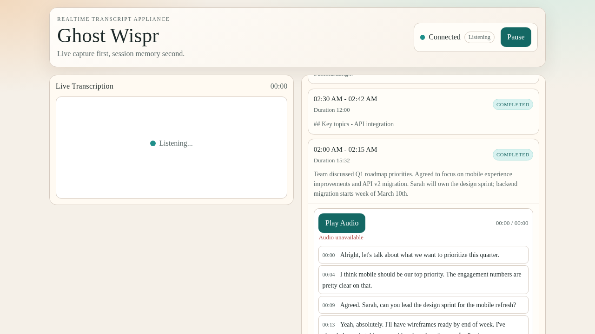

# Ghost Wispr

Always-on transcription appliance. Listens to your microphone, detects speech, and produces timestamped transcripts with session history, audio playback, and AI-generated summaries.



## What it does

Ghost Wispr runs as a background service on a machine with a microphone (e.g. a Raspberry Pi in a meeting room). It captures audio continuously, detects silence gaps to split recordings into sessions, sends audio to Deepgram for real-time transcription, and stores everything locally in SQLite.

When a session ends, it optionally generates a summary via OpenAI and can sync audio files to Google Drive.

The web UI shows live transcription on the left and session history on the right. Click any past session to expand its full transcript and play back audio.

A summary whose model answers with no words (an empty summary, or only punctuation such as `...`) is not stored: Ghost Wispr asks again, and if every attempt answers so, the summary fails. The session keeps its last good summary, and its card shows why the summary failed and a "Retry summary" button. While a summary is being made, the card says so.


## Architecture

```
Microphone → Deepgram WebSocket → Session Manager → SQLite
                                       ↓
                                  Audio Recorder (MP3)
                                       ↓
                                  WebSocket Hub → Browser
```

**Backend** (Go):
- `cmd/ghost-wispr/main.go` — entry point, microphone/Deepgram orchestration
- `internal/session/` — silence-based session detection and lifecycle management
- `internal/audio/` — PCM recording with MP3 encoding
- `internal/storage/` — SQLite persistence (WAL mode)
- `internal/server/` — HTTP API, WebSocket event hub, SPA serving
- `internal/summary/` — OpenAI summarization
- `internal/gdrive/` — Google Drive sync (optional)

**Frontend** (Svelte 5):
- PWA with offline support
- Real-time transcript updates via WebSocket
- Session history grouped by date
- Audio playback with seek-to-segment

## Requirements

- Go 1.25+
- Node.js 22+
- A USB or built-in microphone (PortAudio)
- Deepgram API key (required for transcription)
- OpenAI API key (optional, for summaries)

### System dependencies

PortAudio is required for microphone access:

```bash
# Debian/Ubuntu/Raspberry Pi
sudo apt-get install portaudio19-dev

# macOS
brew install portaudio
```

## Setup

```bash
# Clone
git clone https://github.com/sjawhar/ghost-wispr.git
cd ghost-wispr

# Configure
cp .env.example .env
# Edit .env with your API keys

# Build
make build

# Run
source .env && ./ghost-wispr
```

The web UI is available at `http://localhost:8080`.

## Configuration

Settings live in `ghost-wispr.yaml` (see `ghost-wispr.yaml.example`). Environment variables with the `GHOST_WISPR_` prefix override them, and API keys are read only from the environment. See `.env.example` for the full list.

| Variable | Required | Default | Description |
|----------|----------|---------|-------------|
| `GHOST_WISPR_DEEPGRAM_API_KEY` | Yes | — | Deepgram API key for transcription |
| `GHOST_WISPR_OPENAI_API_KEY` | No | — | OpenAI key for session summaries |
| `GHOST_WISPR_SUMMARIZATION_MODEL` | No | `openai/gpt-4o-mini` | Summary model, as `provider/model` |
| `GHOST_WISPR_DB_PATH` | No | `data/ghost-wispr.db` | SQLite database path |
| `GHOST_WISPR_AUDIO_DIR` | No | `data/audio` | Directory for audio files |
| `GHOST_WISPR_SILENCE_TIMEOUT` | No | `30s` | Silence duration to end a session |
| `GHOST_WISPR_MIC_SAMPLE_RATE` | No | `16000` | Preferred microphone sample rate |
| `GHOST_WISPR_MIC_SAMPLE_RATES` | No | `48000,44100,32000,24000` | Fallback sample rates to try |
| `GHOST_WISPR_GDRIVE_FOLDER_ID` | No | — | Google Drive folder for audio sync |
| `GHOST_WISPR_PUBLIC_URL` | No | — | The unit's own HTTPS address (`public_url`), such as its tailnet name: pages there may use the API, and Envoy events link to sessions under it |
| `GHOST_WISPR_RECORDING_RULES` | No | — | The rules the web UI shows under Recording rules (`recording_rules`), as a JSON list of strings. A settings save writes them into `ghost-wispr.yaml`, where they stay after the variable is removed |
| `google_credentials_file` | No | — | Authoritative Google credential file; when empty, Application Default Credentials are used |

`ghost-wispr google-id-token --audience URL` mints an ID token from this credential file. Use `--credentials PATH` to override it for one command.

## Recording rules

`recording_rules` in `ghost-wispr.yaml` lists the rules that people in the room agree to. When
the list has a rule, the web UI shows a Recording rules button in its header. Its dialog shows
each rule as written, as plain text, and tells people how to pause the recorder and how to have a
segment deleted. With no rules, the page shows no button. `GET /api/config` returns the list as
`recording_rules`.

```yaml
recording_rules:
  - Say so before the meeting if you do not want it recorded.
  - Anyone can pause the recorder, at any time.
  - Ask the office manager to delete a segment.
```

## Recording light

With `indicator_light: blink1` the recorder captures only while the blink(1) reads back red.
With the light missing, or not reading back red, it starts no microphone and refuses a resume;
if the light fails while it records, capture stops within one check (a second) without saving a
pause. `/api/status` then names the cause in a warning and reports `capture_state`
`light_unavailable`, and capture comes back once the light reads back red again, unless someone
paused it meanwhile. Any other value of `indicator_light` stops the recorder from starting, so a
typo cannot turn the light check off; leave it unset for a recorder with no light.

Every microphone open, and PortAudio's device scan, which opens the microphone too, waits for
the blink(1) to read back red and keeps it red until the open has finished, so no microphone opens
while the light is off. While the microphone is missing, the start-up retry tries again every 15
seconds, and the blink(1) shows red for as long as each try takes. A unit that starts paused scans
only at its first resume, so its speaker plays only from then on: until then `/api/status` warns
`Speaker unavailable until the microphone starts`, and `POST /api/tts/speak` answers `409` with
that reason. Audio passes only while the light has stayed red since the microphone opened: once
the light went off while the microphone was open, as when no audio reached the recording
(`no_audio`), the recorder drops what the microphone holds, closes it and opens it again under a
new red check.

## Deployment

The office recorder runs a verified arm64 release binary on a Raspberry Pi 5. The Pi is
provisioned from `deploy/pi/` and is managed through its user services and nightly updater.
Follow the [office recorder Pi runbook](docs/pi-setup.md) for the required infrastructure
outputs, credential bundle, provisioning command, tailnet join, and acceptance checks.

## API

| Method | Path | Description |
|--------|------|-------------|
| `GET` | `/api/sessions?date=YYYY-MM-DD` | List sessions for a date (defaults to today) |
| `GET` | `/api/sessions/{id}` | Get session details with transcript segments |
| `GET` | `/api/sessions/{id}/audio` | Stream session audio (supports range requests) |
| `POST` | `/api/pause` | Pause capture. The pause persists through restarts; the active session ends, the microphone closes at once, even while its read waits for a device that delivers nothing, and nothing is recorded or sent to Deepgram until resume. If the microphone cannot be closed, `/api/status` warns until it is. A unit that starts paused opens the microphone, and connects to Deepgram, only when it resumes. When enabled, the Pi power button and the Jabra's Mute button toggle the same control, and the Jabra's mute light is on while capture is paused. |
| `POST` | `/api/resume` | Resume a persisted pause. With a configured light, it confirms red before returning, and a missing light refuses the resume. A `204` accepts the request, but a second gate-open check can still keep capture paused if the light fails while the session settles; the page receives `status_changed`. Returns `500` if red cannot be confirmed at request time or persistent state cannot be saved. Audio flows only after the paused session has ended and the microphone reopens; while the unit speaks through the Jabra, the microphone reopens once the speech ends, and a pause meanwhile cancels the resume. |
| `GET` | `/api/status` | `paused` (the switch), `capturing` (audio is flowing), `capture_state` (`paused`, `light_unavailable` while the switch is on but the recording light is missing or does not read back red, `resuming` from a resume until the microphone has started and Deepgram has connected, or the start failed, for at most 30 s, or for as long as the microphone waits for speech on the Jabra to end before it opens, `stalled`, `mic_unavailable`, `no_audio` while the microphone and the gate are open but no audio has reached the recording for 2 s, so nothing is recorded and the light is off, or `capturing`), `kept_raw_recordings` and `kept_raw_bytes` (every raw `.pcm` recording the app keeps: those of sessions that ended without a recording, which it tries again to save after every Drive sync sweep, those beside a saved recording, which it erases once Drive has it, and those it neither saves nor erases), `kept_raw_by_hand` (the sessions of those last ones, which wait for a person), `gc_hold` (null, or the last GC pass held back because Drive sync is off, has no folder, or cannot verify that Drive still has the session audio), `unverified_sessions` (sessions an earlier version synced that GC keeps until a sync re-checks their Drive documents), `unit_only_sessions` (sessions kept on this unit only, with their audio, because their Drive folder is gone or unreadable; with a warning while there are any), and the active session |
| `WS` | `/ws` | Real-time events (transcripts, session state) |

With no `GHOST_WISPR_AUTH_TOKEN`, as on the Pi, tailnet membership is the only access control. So that a page on another site,
open in a tailnet member's browser, cannot use it, the `/ws` handshake and every `POST`, `PATCH`,
`PUT` and `DELETE` whose `Origin` header names another site (or `null`) get `403`. The accepted
origins are the host the request came to and `public_url`. A client that sends no `Origin`, such
as `curl` or an agent, is not affected.

### Envoy events

With `envoy_enabled`, Ghost Wispr posts `session_started`, `session_ended` and `summary_ready` to
`envoy_webhook_url`; Envoy publishes them under
`notifications.ghostwispr.<session>.{session.started,session.ended,summary.ready}`. No event
carries a session's title, summary or transcript, because Envoy keeps every event for 72 hours
and a segment deletion cannot recall it. Each payload has `session_id`, `type`, `started_at`,
`ended_at` (once the session has ended), `duration` in seconds, `drive_folder_url` (once the
session has a Drive folder) and `session_url` (`public_url` + `/api/sessions/{id}`, when
`public_url` is set). `summary_ready` adds `summary_preset`, `summary_model` and `version`. To
read the text, fetch `session_url`, which returns what is left after any deletion.
`GET /api/openapi.json` describes the payload under `webhooks`.

Each event is signed with Envoy's webhook signing key, which Ghost Wispr reads from Google Secret
Manager with its Google credential (`google_credentials_file`): the secret version
`envoy_webhook_secret_name` (`GHOST_WISPR_ENVOY_WEBHOOK_SECRET_NAME`), such as
`projects/example-project/secrets/example-signing-secret/versions/latest`. It has no default:
with Envoy enabled and no secret named, Ghost Wispr sends no event and warns at startup. It keeps
the key in memory and reads it again once when Envoy answers 401, so a rotated key needs no
change on the unit. While the key cannot be read, no event is sent and `/api/status` warns. The
five-minute sweep reads the key again, so the warning clears within five minutes of the key
becoming readable, and the unsent events go out then. Recording does not depend on it.
`GHOST_WISPR_ENVOY_WEBHOOK_SECRET` is no longer read, and a start that finds it warns.

## Development

```bash
# Run backend tests (cmd/ghost-wispr embeds the web build, so run `make build` first)
go test ./...

# Run frontend tests
cd web && npm test

# Frontend dev server (with hot reload, proxies API to :8080)
cd web && npm run dev
```

## License

MIT
