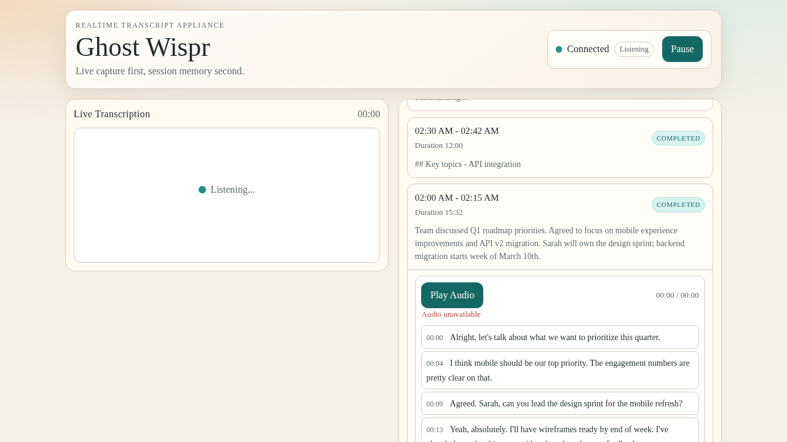
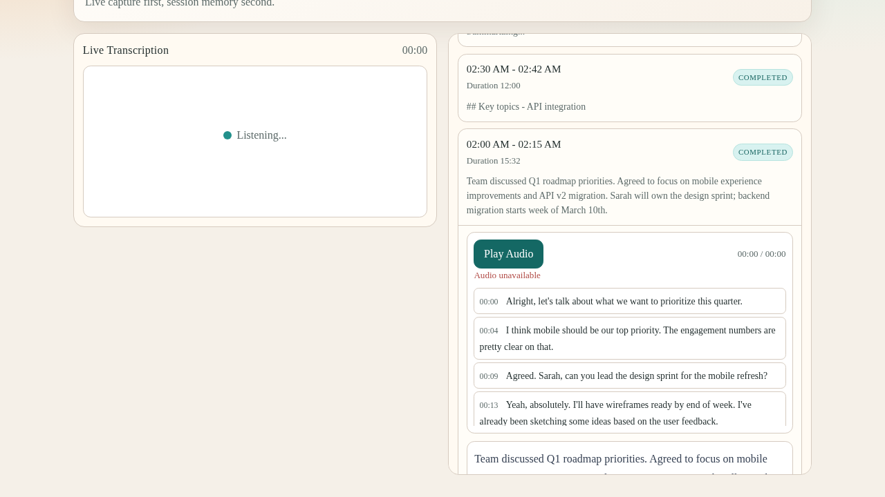

# Ghost Wispr

Always-on transcription appliance. Listens to your microphone, detects speech, and produces timestamped transcripts with session history, audio playback, and AI-generated summaries.



## What it does

Ghost Wispr runs as a background service on a machine with a microphone (e.g. a Raspberry Pi in a meeting room). It captures audio continuously, detects silence gaps to split recordings into sessions, sends audio to Deepgram for real-time transcription, and stores everything locally in SQLite.

When a session ends, it optionally generates a summary via OpenAI and can sync audio files to Google Drive.

The web UI shows live transcription on the left and session history on the right. Click any past session to expand its full transcript and play back audio.



## Architecture

```
Microphone → Deepgram WebSocket → Session Manager → SQLite
                                       ↓
                                  Audio Recorder (MP3)
                                       ↓
                                  WebSocket Hub → Browser
```

**Backend** (Go):
- `cmd/ghost-wispr/main.go` — entry point, microphone/Deepgram orchestration
- `internal/session/` — silence-based session detection and lifecycle management
- `internal/audio/` — PCM recording with MP3 encoding
- `internal/storage/` — SQLite persistence (WAL mode)
- `internal/server/` — HTTP API, WebSocket event hub, SPA serving
- `internal/summary/` — OpenAI summarization
- `internal/gdrive/` — Google Drive sync (optional)

**Frontend** (Svelte 5):
- PWA with offline support
- Real-time transcript updates via WebSocket
- Session history grouped by date
- Audio playback with seek-to-segment

## Requirements

- Go 1.25+
- Node.js 22+
- A USB or built-in microphone (PortAudio)
- Deepgram API key (required for transcription)
- OpenAI API key (optional, for summaries)

### System dependencies

PortAudio is required for microphone access:

```bash
# Debian/Ubuntu/Raspberry Pi
sudo apt-get install portaudio19-dev

# macOS
brew install portaudio
```

## Setup

```bash
# Clone
git clone https://github.com/sjawhar/ghost-wispr.git
cd ghost-wispr

# Configure
cp .env.example .env
# Edit .env with your API keys

# Build
make build

# Run
source .env && ./ghost-wispr
```

The web UI is available at `http://localhost:8080`.

## Configuration

Settings live in `ghost-wispr.yaml` (see `ghost-wispr.yaml.example`). Environment variables with the `GHOST_WISPR_` prefix override them, and API keys are read only from the environment. See `.env.example` for the full list.

| Variable | Required | Default | Description |
|----------|----------|---------|-------------|
| `GHOST_WISPR_DEEPGRAM_API_KEY` | Yes | — | Deepgram API key for transcription |
| `GHOST_WISPR_OPENAI_API_KEY` | No | — | OpenAI key for session summaries |
| `GHOST_WISPR_SUMMARIZATION_MODEL` | No | `openai/gpt-4o-mini` | Summary model, as `provider/model` |
| `GHOST_WISPR_DB_PATH` | No | `data/ghost-wispr.db` | SQLite database path |
| `GHOST_WISPR_AUDIO_DIR` | No | `data/audio` | Directory for audio files |
| `GHOST_WISPR_SILENCE_TIMEOUT` | No | `30s` | Silence duration to end a session |
| `GHOST_WISPR_MIC_SAMPLE_RATE` | No | `16000` | Preferred microphone sample rate |
| `GHOST_WISPR_MIC_SAMPLE_RATES` | No | `48000,44100,32000,24000` | Fallback sample rates to try |
| `GHOST_WISPR_GDRIVE_FOLDER_ID` | No | — | Google Drive folder for audio sync |
| `google_credentials_file` | No | — | Authoritative Google credential file; when empty, Application Default Credentials are used |

## Consent rule

Record only while the light is on. Anyone may pause it at any time without a reason.
Transcripts are readable by Theorem staff only. A person can ask for a segment to be deleted.

`ghost-wispr google-id-token --audience URL` mints an ID token from this credential file. Use `--credentials PATH` to override it for one command.
## Deployment

The office recorder runs a verified arm64 release binary on a Raspberry Pi 5. The Pi is
provisioned from `deploy/pi/` and is managed through its user services and nightly updater.
Follow the [office recorder Pi runbook](docs/pi-setup.md) for the required infrastructure
outputs, credential bundle, provisioning command, tailnet join, and acceptance checks.

## API

| Method | Path | Description |
|--------|------|-------------|
| `GET` | `/api/sessions?date=YYYY-MM-DD` | List sessions for a date (defaults to today) |
| `GET` | `/api/sessions/{id}` | Get session details with transcript segments |
| `GET` | `/api/sessions/{id}/audio` | Stream session audio (supports range requests) |
| `POST` | `/api/pause` | Pause capture. The pause persists through restarts; the active session ends and nothing is recorded or sent to Deepgram until resume. When enabled, the Pi power button toggles the same control. |
| `POST` | `/api/resume` | Resume a persisted pause. When a configured light is present, it confirms red before returning. A `204` accepts the request, but a second gate-open check can still keep capture paused if the light fails while the session settles; the page receives `status_changed`. Returns `500` if red cannot be confirmed at request time or persistent state cannot be saved. Audio flows only after the paused session has ended and the microphone restarts. |
| `GET` | `/api/status` | `paused` (the switch), `capturing` (audio is flowing), `capture_state` (`paused`, `resuming`, `stalled`, `mic_unavailable` or `capturing`), `kept_raw_recordings` and `kept_raw_bytes` (raw `.pcm` recordings that could not be saved), `gc_hold` (null, or the last GC pass held back because Drive sync is off, has no folder, or cannot verify that Drive still has the session audio), `unverified_sessions` (sessions an earlier version synced that GC keeps until a sync re-checks their Drive documents), `unit_only_sessions` (sessions kept on this unit only, with their audio, because their Drive folder is gone or unreadable; with a warning while there are any), and the active session |
| `WS` | `/ws` | Real-time events (transcripts, session state) |

## Development

```bash
# Run backend tests
go test ./...

# Run frontend tests
cd web && npm test

# Frontend dev server (with hot reload, proxies API to :8080)
cd web && npm run dev
```

## License

MIT
